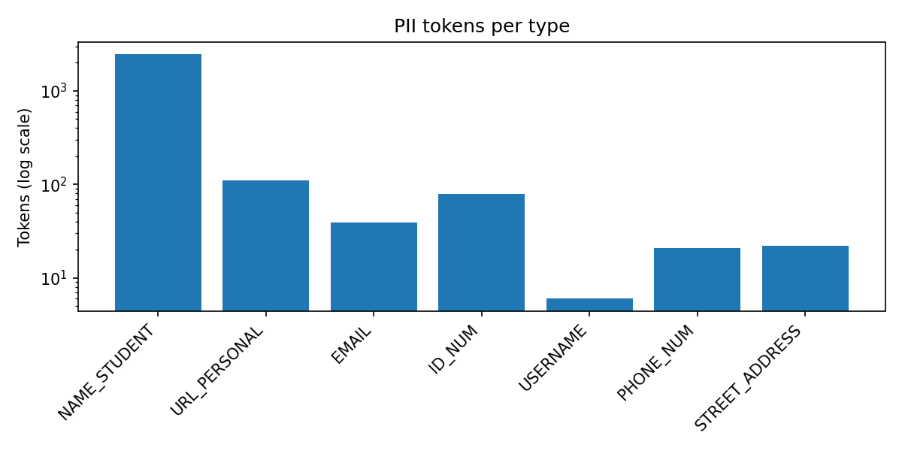
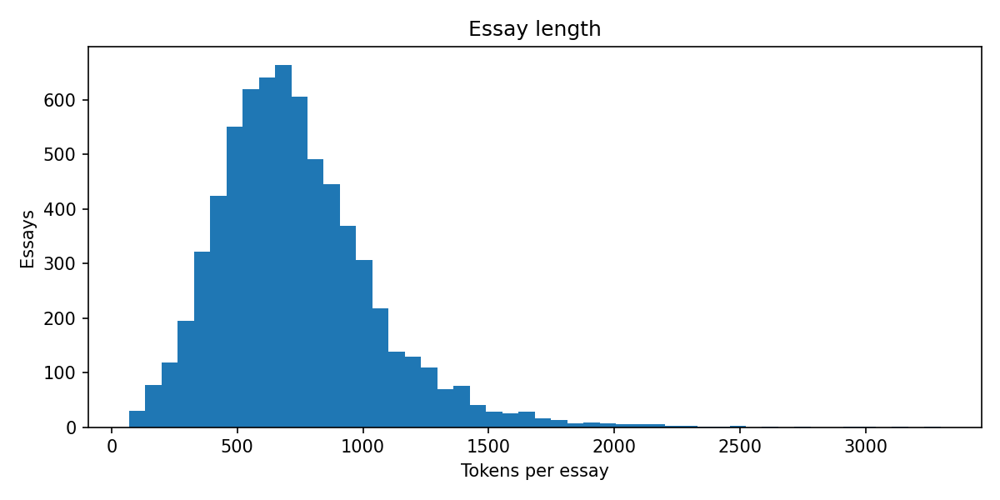

# 🛡️ PrivacyShield

**A deep learning model that finds and masks personal information (PII) in text.**

Fine-tuned DeBERTa-v3 on student essays from the Kaggle "PII Data Detection" competition dataset.

---

## 📖 About

PII (Personally Identifiable Information) means names, emails, phone numbers, usernames and similar details that can identify a person. Organizations must remove it from text before sharing the text or using it to train AI, because of privacy laws such as GDPR.

PrivacyShield reads text, labels every word as a type of PII or "not PII", and replaces the PII with a tag.

| | |
|---|---|
| **Input** | `My name is Sara Ali and my email is sara.ali@gmail.com` |
| **Output** | `My name is [NAME_STUDENT] and my email is [EMAIL]` |

**Task type:** supervised learning, token classification (NER), by fine-tuning a pre-trained transformer.

---

## ✨ Key Features

- **PII detection** for 7 types: `NAME_STUDENT`, `EMAIL`, `URL_PERSONAL`, `ID_NUM`, `PHONE_NUM`, `STREET_ADDRESS`, `USERNAME`
- **Handles long essays** by splitting them into overlapping 512-token chunks
- **Imbalance handling**: only about 0.05% of tokens are PII, so training uses negative sampling
- **Threshold tuning** to favour recall, because missing PII is worse than a false alarm
- **Redaction function** that turns raw text into masked text
- **Per-type evaluation** with precision, recall and F5

---

## 📊 Dataset

[The Learning Agency Lab - PII Data Detection](https://www.kaggle.com/competitions/pii-detection-removal-from-educational-data) (Kaggle)

| Fact | Value |
|---|---|
| Essays | 6,807 |
| Essays that contain PII | 945 (14%) |
| Labels | 13 (`O` for "not PII" plus 12 `B-`/`I-` PII labels across 7 types) |
| PII share of all tokens | about 0.05% |
| Average essay length | 733 words (maximum 3,298) |
| Essays longer than 512 words | 5,171 (76%) |

Most PII is student names (about 90%). Some types are extremely rare: the whole dataset has only 6 `B-USERNAME` tokens.




---

## 🧠 Method

1. **Split by essay** into train (5,785 essays) and validation (1,022 essays), so no essay appears in both
2. **Tokenize** with the DeBERTa-v3 tokenizer and align word labels to sub-word tokens
3. **Chunk** each essay into 512-token windows with a stride of 128, so long essays are not cut off
4. **Negative sampling:** keep all 984 chunks that contain PII and a random 25% of the 10,562 chunks that do not, giving 3,624 training chunks
5. **Fine-tune** `microsoft/deberta-v3-small` for 3 epochs (learning rate 3e-5, batch size 8, fp16) in about 10 minutes on a Kaggle GPU
6. **Tune the decision threshold:** predict PII whenever P(not PII) is below a threshold, and pick the best threshold on the validation set
7. **Evaluate** with precision, recall and F5 (F5 counts recall 25 times more than precision)

---

## 🏆 Results

All numbers are on the held-out validation set (2,026 chunks), token-level. F5 is computed by my own evaluation code and is close to, but not identical to, the competition's official scorer.

### Training (default argmax prediction)

| Epoch | Precision | Recall | F5 |
|---|---|---|---|
| 1 | 0.851 | 0.753 | 0.756 |
| 2 | 0.775 | 0.851 | 0.848 |
| 3 | 0.716 | 0.877 | 0.869 |

### Threshold tuning

| Threshold | Precision | Recall | F5 |
|---|---|---|---|
| 0.50 | 0.699 | 0.883 | 0.874 |
| 0.70 | 0.628 | 0.904 | 0.889 |
| 0.90 | 0.547 | 0.937 | 0.912 |
| **0.95** | **0.519** | **0.950** | **0.920** |
| 0.99 | 0.436 | 0.958 | 0.916 |
| 0.999 | 0.301 | 0.964 | 0.889 |

The best threshold (0.95) raises F5 from 0.869 to **0.920** without retraining.

### Per-type results (threshold 0.95)

| PII type | Validation examples | Precision | Recall | F5 |
|---|---|---|---|---|
| NAME_STUDENT | 416 | 0.560 | 0.983 | 0.955 |
| EMAIL | 13 | 0.929 | 1.000 | 0.997 |
| URL_PERSONAL | 21 | 0.233 | 1.000 | 0.888 |
| ID_NUM | 8 | 0.304 | 0.875 | 0.816 |
| PHONE_NUM | 8 | 0.267 | 0.500 | 0.484 |
| STREET_ADDRESS | 10 | 0.500 | 0.100 | 0.103 |
| USERNAME | 2 | 0.000 | 0.000 | 0.000 |

Types with only a handful of validation examples have noisy scores.

---

## 🔍 Redaction Demo

Threshold 0.5, on short sentences:

| Input | Output |
|---|---|
| My name is Sara Ali and my email is sara.ali@gmail.com | My name is **[NAME_STUDENT]** and my email is **[EMAIL]** |
| Hello, I am Nathalie Sylla from Paris. You can visit my site at https://nathalie.me | Hello, I am **[NAME_STUDENT]** from Paris. You can visit my site at **[URL_PERSONAL]** |
| Contact Ahmed Khan on 0300-1234567 about the project. | Contact **[NAME_STUDENT]** on **[ID_NUM]** about the project. |
| The weather was nice and we walked to the park after class. | *(unchanged, no PII found)* |

---

## ⚠️ Limitations

- **Rare types are weak.** `STREET_ADDRESS`, `PHONE_NUM` and `USERNAME` have very few training examples. The model misses most addresses (recall 0.10), and a phone number was labelled `ID_NUM` in the demo.
- **Low precision at the best threshold.** At 0.95 the model finds 95% of PII but about half of its flags are false alarms. This is a deliberate trade-off for F5.
- **Optimistic scores.** The threshold was chosen on the same validation set that is reported, so 0.920 is slightly optimistic.
- **Short text is harder.** The model was trained on essay-length chunks. On one-line sentences it is less confident, and a high threshold (0.9 or more) flags ordinary words. A threshold of 0.5 works better there.
- **Dataset design.** City names such as "Paris" are not labelled as PII in this dataset, so the model does not mask them.
- **Domain.** It was trained on English student essays only and may not transfer to other kinds of text.
- **Small model.** `deberta-v3-small` was used so that training fits on a free GPU.

---

## 🛠️ Technologies & Tools

| Category | Technology |
|---|---|
| Language | Python |
| Model | DeBERTa-v3-small (Hugging Face) |
| Deep learning | PyTorch, Transformers, Datasets, Accelerate |
| Data and evaluation | pandas, NumPy, scikit-learn |
| Visualization | matplotlib |
| Platform | Kaggle Notebook (GPU) |
| Version control | Git and GitHub |

### 📦 Key Packages

```
torch, transformers, datasets, accelerate, scikit-learn,
pandas, numpy, matplotlib, sentencepiece, protobuf
```

## 📁 Project Structure

```
privacyshield-pii-detection/
├── README.md
├── requirements.txt
├── notebooks/
│   └── privacyshield_pii_detection.ipynb   # full pipeline: data, training, evaluation, demo
└── results/
    ├── pii_types.png                       # PII tokens per type
    ├── essay_length.png                    # essay length histogram
    ├── threshold_sweep.csv                 # precision / recall / F5 per threshold
    └── per_type_results.csv                # scores for each PII type
```

---

## 🔮 Future Work

- Add extra training data (Ai4Privacy `open-pii-masking-500k`) to improve rare types
- Try `deberta-v3-base` and compare scores
- Analyse errors in detail
- Wrap the model in a FastAPI endpoint and a Docker image for a live demo

---

## 🙏 Credits

- Competition and dataset: [The Learning Agency Lab - PII Data Detection](https://www.kaggle.com/competitions/pii-detection-removal-from-educational-data) on 
- Model: [microsoft/deberta-v3-small](https://huggingface.co/microsoft/deberta-v3-small)
